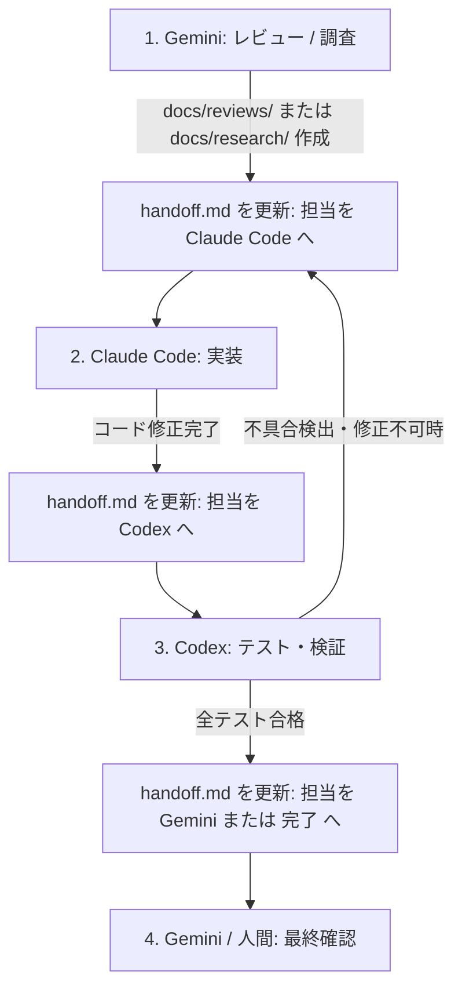

# このリポジトリの作業方針（AGENTS.md）

## 3エージェントの役割分担

| エージェント | 担当 | 主な作業内容 | 専用指示書 |
|---|---|---|---|
| **Claude Code** | 実装 | 新規機能の実装、レビュー指摘に基づくコード改修 | [CLAUDE.md](CLAUDE.md) |
| **Codex** | テスト・修正 | スモークテスト実行、動作検証、軽微なバグ修正 | [CODEX.md](CODEX.md) |
| **Gemini (Antigravity CLI)** | レビュー・リサーチ | コードレビュー、外部リサーチ、メディアプロンプト作成 | [GEMINI.md](GEMINI.md) |

---

## 相互連携プロトコル（タスク引き継ぎフロー）

3エージェントは [docs/handoff.md](docs/handoff.md) をハブとして非同期に作業を引き継ぎます。

- **Gemini**: 実装コードを原則直接編集せず、指摘・修正案を `docs/reviews/` にまとめ、`docs/handoff.md` でClaude Codeに引き渡す。
- **Claude Code**: レビューを元にコードを実装し、テスト内容を指定して `docs/handoff.md` でCodexに引き渡す。
- **Codex**: `scratchpad/smoke/test_otazune.js` 等を実行し、不具合の修正と検証を行って結果を記録する。
- 詳細は [docs/agent-workflow.md](docs/agent-workflow.md) を参照。

---

## ワークツリー・環境間の同期

- Geminiはローカル原本ターミナル（`C:\Users\USER\Desktop\Work\01_アプリ\ai-otazune`）で稼働します。
- Claude Code / Codex がOrca等の別ワークツリー（例: `C:\Users\USER\orca\workspaces/ai-otazune/featherstar`）で稼働する場合、未コミットの変更やファイルは自動共有されません。
- 変更やドキュメントの同期手順は [docs/agent-workflow.md](docs/agent-workflow.md) に記載されています。

---

## 2026-10-13：Antigravity CLIへの移行

- 上記の「Gemini CLI」は、以後「Gemini担当（公式Antigravity CLI、起動コマンド `agy`）」として扱う。個人向けの旧Gemini CLIではGoogle AI Proの認証経路が終了している。
- Claude Code＝実装、Codex＝テスト・修正、Gemini担当＝レビュー・リサーチ・メディア用プロンプト作成という分担を継続する。
- Gemini担当はOrcaとは別の対話型ターミナルから同じリポジトリを扱う。Orcaへの登録や他エージェントからの自動呼び出しは行わない。
- `~/.gemini/antigravity-cli/settings.json` の `useG1Credits: false` を維持し、追加クレジットを使用しない。APIキー・Vertex AIへの切り替えや課金設定を行わない。
- 本節は旧Gemini CLIの利用・認証に関する上記記述より優先する。詳細は `GEMINI.md` と `docs/antigravity-cli-setup.md` を参照する。
