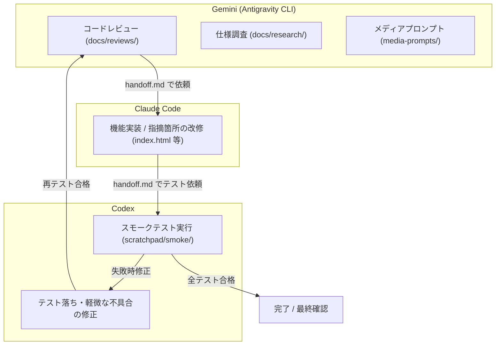

# 3エージェント相互連携ガイド（Claude Code × Codex × Gemini）

更新日: 2026-10-13

本リポジトリでは、3つのAIエージェントが専門分野を分担し、非同期でタスクを引き継ぎながら開発を進めます。

---

## 1. 役割分担と作業フロー



### 役割一覧

| エージェント | 担当 | 実行環境 | 専用指示書 |
|---|---|---|---|
| **Gemini** | レビュー・リサーチ・メディアプロンプト | 独立ターミナル（`agy` / Google AI Pro） | [GEMINI.md](../GEMINI.md) |
| **Claude Code** | 実装（コード作成・改修） | Orcaワークツリー または ターミナル | [CLAUDE.md](../CLAUDE.md) |
| **Codex** | テスト実行・検証・不具合修正 | Orcaワークツリー または ターミナル | [CODEX.md](../CODEX.md) |

---

## 2. 引き継ぎ管理（docs/handoff.md）の使い方

作業の受け渡しは、すべて [docs/handoff.md](handoff.md) の更新によって行います。

1. **GeminiからClaude Codeへ渡すとき**:
   - `docs/reviews/YYYY-MM-DD-*.md` を作成。
   - `docs/handoff.md` の「現在の担当エージェント」を `Claude Code` に設定。
   - レビューの修正案と対象ファイルをタスク欄に記載。

2. **Claude CodeからCodexへ渡すとき**:
   - 実装コード（`index.html` 等）を改修。
   - `docs/handoff.md` の「現在の担当エージェント」を `Codex` に設定。
   - テストしてほしい内容や修正した関数名をタスク欄に記載。

3. **CodexからGemini / 完了へ渡すとき**:
   - `node scratchpad/smoke/test_otazune.js` を実行し、全項目合格を確認。
   - `docs/handoff.md` の「作業ログ」に合格結果を記録し、「現在の担当エージェント」を `Gemini` または `完了` に設定。

---

## 3. Orcaワークツリーとの同期手順

Gemini（原本：`C:\Users\USER\Desktop\Work\01_アプリ\ai-otazune`）と、
Orcaで動作するClaude Code / Codex（`C:\Users\USER\orca\workspaces\ai-otazune\featherstar`）は別の作業ツリーです。
未コミットのドキュメントやコードを相互に反映するために、同梱の [sync-worktree.ps1](../sync-worktree.ps1) を使用します。

### ステータス確認
```powershell
.\sync-worktree.ps1 -Status
```
両ツリーにおける指示書・ドキュメントの存在状況やコードの更新日時を確認します。

### 原本 → Orca へ指示を反映（Geminiがレビューを作成した直後など）
```powershell
.\sync-worktree.ps1 -ToOrca
```
`AGENTS.md`, `CLAUDE.md`, `CODEX.md`, `docs/reviews/`, `docs/handoff.md` がOrca側へコピーされ、Claude CodeやCodexが最新の指示を読み取れるようになります。

### Orca → 原本 へコードを反映（Claude/Codexが修正・テストを終えた直後など）
```powershell
.\sync-worktree.ps1 -FromOrca
```
Orca側で修正された `index.html` や更新された `docs/handoff.md` が原本へコピーされ、Geminiが最新コードを再レビュー・確認できるようになります。

---

## 4. 各エージェントへの依頼プロンプト例

### Claude Code へのプロンプト例
```text
CLAUDE.md と docs/handoff.md を確認してください。
Geminiのレビュー（docs/reviews/2026-10-13-index-html-review.md）の指摘事項に従って index.html を修正してください。
修正が完了したら、docs/handoff.md を更新して Codex にテストを引き継いでください。
```

### Codex へのプロンプト例
```text
CODEX.md と docs/handoff.md を確認してください。
Claude Codeが修正した index.html に対し、スモークテスト（node scratchpad/smoke/test_otazune.js）を実行してください。
不具合があれば修正し、全テスト合格後に docs/handoff.md を更新してください。
```

### Gemini へのプロンプト例
```text
GEMINI.md と docs/handoff.md を確認してください。
Codexによるテスト検証が完了した index.html の最終確認を行い、
問題がなければ docs/handoff.md のステータスを「完了」にしてください。
実装コードは直接編集しないでください。
```
